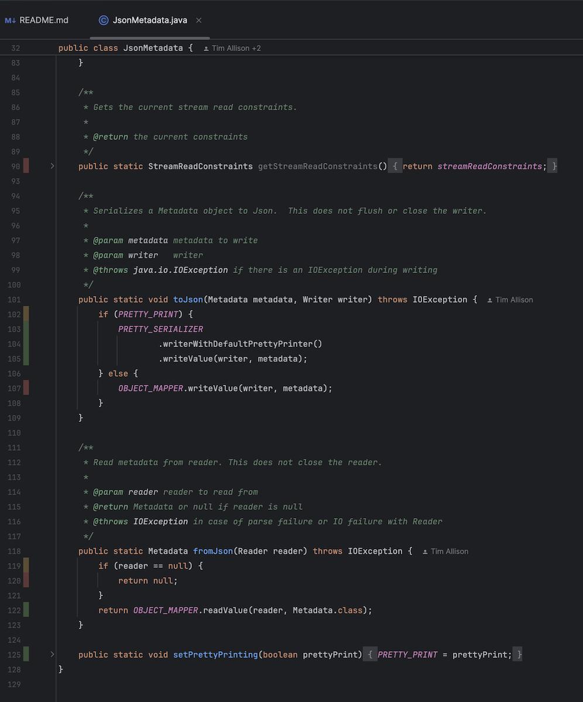
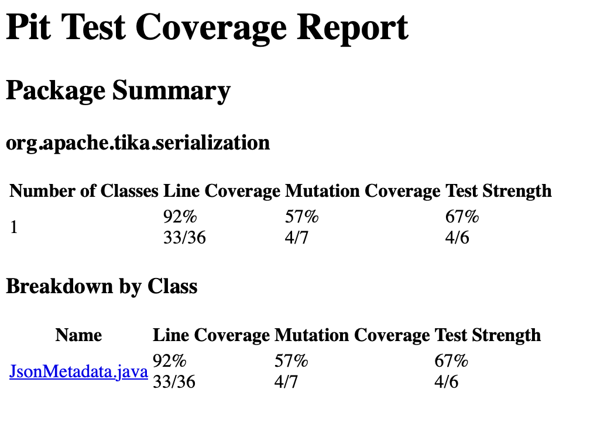
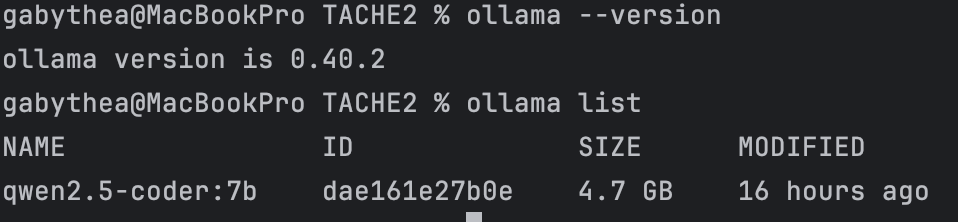
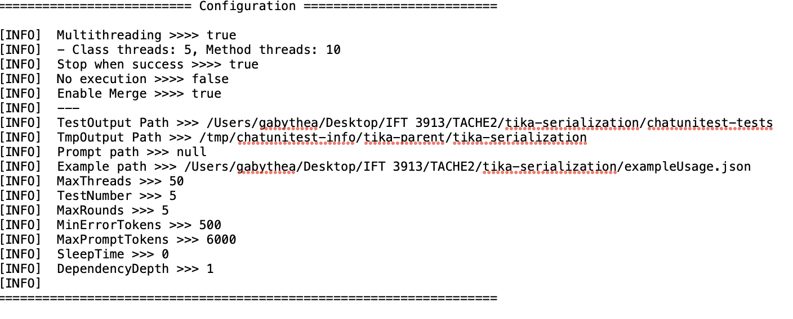
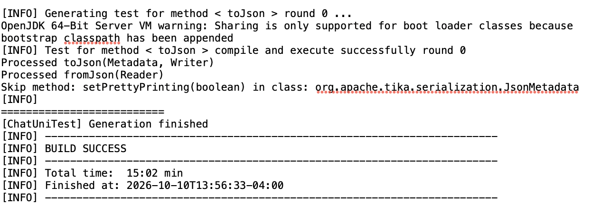
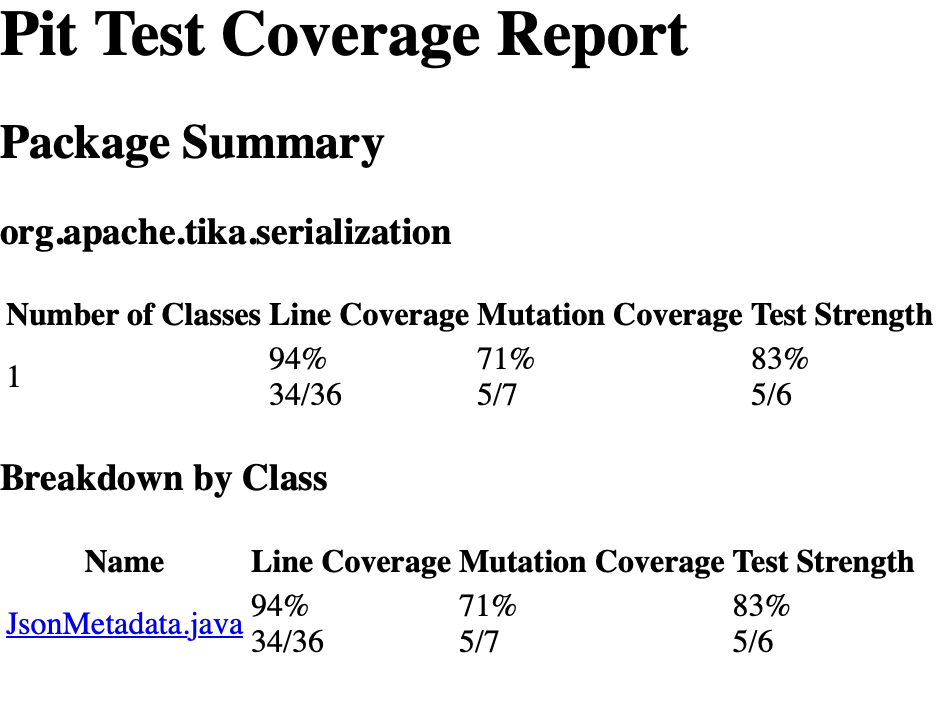
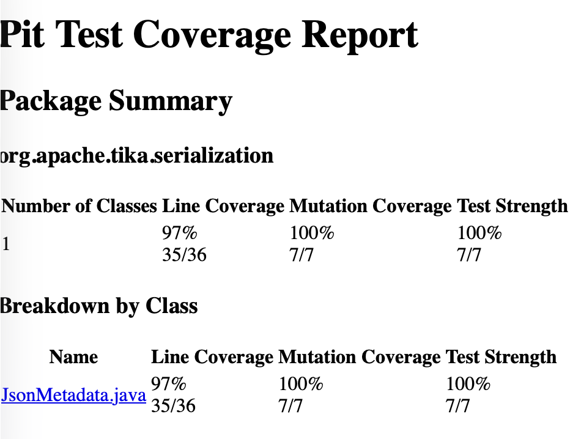

# Tâche 2 : ChatUniTest et pitest sur JsonMetadata


On a travaillé dans le module `tika-serialization` de Tika, sur la classe `org.apache.tika.serialization.JsonMetadata`.

Outils : JDK Temurin 17.0.20.1, Maven wrapper du projet, Ollama 0.40.2 avec le modèle `qwen2.5-coder:7b`, `chatunitest-maven-plugin` 1.4.1, `pitest-maven` 1.25.7 avec `pitest-junit5-plugin` 1.2.3.


## 1. Classes à tester

On a lancé tous les tests du module avec la couverture d'IntelliJ. `JsonMetadata` a déjà des tests (`JsonMetadataTest`) mais n'est pas couverte à 100 % : 90 % des lignes (27/30) et seulement 50 % des branches (2/4). C'est aussi une petite classe avec peu de dépendances, donc plus facile pour un petit modèle local.

Les lignes rouges dans IntelliJ :

- ligne 90, `getStreamReadConstraints()` : aucun test n'appelle le getter.
- lignes 119-120, `if (reader == null) return null;` : aucun test ne passe `null` à `fromJson`.
- ligne 107, la branche `else` de `toJson` (mode compact) : bizarre, car des tests appellent `toJson`. On pense que c'est parce que `testBasicSerializationAndDeserialization` active le pretty print (`PRETTY_PRINT` est un champ statique) et ne le remet jamais à `false`. C'est une explication de notre part, on ne l'a pas prouvée.



Ensuite on a ajouté pitest et lancé une première analyse avec seulement `JsonMetadataTest`. Résultat : 7 mutants générés, 4 tués, donc 57 %. Les 3 mutants vivants ou non couverts :

- ligne 82 : suppression de l'appel à `rebuildObjectMappers()` (survécu, seul `testLargeValues` passe par cette ligne)
- ligne 91 : `getStreamReadConstraints()` qui retourne `null` (aucune couverture)
- ligne 107 : suppression de `OBJECT_MAPPER.writeValue(...)` (survécu)

pitest compte 33/36 lignes (92 %) alors qu'IntelliJ dit 27/30, les deux outils ne comptent pas pareil.




Donc la classe a des tests, n'est pas à 100 % et a des mutants vivants, ce qui correspond à ce que demande la tâche.


## 2. IA et test

Le modèle tourne en local avec Ollama (`ollama pull qwen2.5-coder:7b`).



ChatUniTest est installé comme plugin Maven dans le `pom.xml` de `tika-serialization` :

```xml
<plugin>
  <groupId>io.github.ZJU-ACES-ISE</groupId>
  <artifactId>chatunitest-maven-plugin</artifactId>
  <version>1.4.1</version>
  <configuration>
    <apiKeys>ollama</apiKeys>
    <model>qwen2.5-coder:7b</model>
    <url>http://localhost:11434/v1/chat/completions</url>
    <maxPromptTokens>6000</maxPromptTokens>
  </configuration>
</plugin>
```

La clé API est obligatoire pour le plugin mais Ollama l'ignore, donc c'est une valeur bidon. L'URL est le endpoint compatible OpenAI d'Ollama en local. Le `maxPromptTokens` était à 2600 (valeur par défaut) au début, on l'a monté à 6000 après la première exécution.

On le lance à la main, il n'est pas branché sur une phase Maven :

```
./mvnw chatunitest:class -DselectClass=JsonMetadata -pl :tika-serialization -Dossindex.skip
```

Le plugin affiche sa configuration au début de chaque exécution :



On ne le lance pas dans la GitHub Action. Les tests générés sont juste des fichiers JUnit, donc ils passent sans Ollama.


## 3. Tests générés

On a fait trois exécutions, toujours avec `-DselectClass=JsonMetadata` (donc seulement cette classe). Le plugin a sauté tout seul `rebuildObjectMappers`, `setStreamReadConstraints`, `getStreamReadConstraints` et `setPrettyPrinting`, il a donc seulement travaillé sur `toJson` et `fromJson`.

- **Exécution 1 (18 min 15 s)** : rien de conservé. Toutes les tentatives échouaient à la compilation avec `package org.mockito does not exist`. Le modèle écrit des imports Mockito (même quand il ne s'en sert pas) et le module n'avait pas Mockito. La boucle de réparation du plugin ne peut pas régler ça, c'est un problème de dépendance.
- **Exécution 2 (20 min 30 s)** : après avoir ajouté `mockito-core` en scope test, un test pour `fromJson` a compilé et passé au tour 2. Mais `toJson` échouait toujours, cette fois avec `package org.mockito.junit.jupiter does not exist` (classe `MockitoExtension`).
- **Exécution 3 (15 min 2 s)** : après avoir ajouté `mockito-junit-jupiter` et monté `maxPromptTokens` à 6000, un test pour `toJson` a compilé et passé au tour 0. Il y avait encore des messages `Exceed max prompt tokens` pour d'autres tentatives, donc la limite plus haute n'a pas tout réglé.



**Où sont les tests générés ?** Dans `tika-serialization/chatunitest-tests/org/apache/tika/serialization/` (copie brute, versionnée dans le dépôt) :

- `JsonMetadata_toJson_3_4_Test.java` (1 test) : gardé
- `JsonMetadata_fromJson_4_0_Test.java` (2 tests) : gardé
- `JsonMetadata_fromJson_4_4_Test.java` : pas gardé, c'est presque un doublon du précédent
- `JsonMetadata_Suite.java` : pas gardé, c'est une classe JUnit 4 (`@RunWith`) et le module n'a pas JUnit 4


**Est-ce que ça compile et s'exécute sans intervention ? Non.** Le plugin dit que les tests des exécutions 2 et 3 compilent et passent, mais seulement après qu'on a ajouté les deux dépendances Mockito à la main. Et une fois copiés dans `src/test/java`, le build a échoué (voir section 4).


## 4. Documentation des tests

Voici le code brut des deux tests générés qu'on a gardés (imports omis), tel que le plugin les a écrits.

<details>
<summary>JsonMetadata_toJson_3_4_Test (brut)</summary>

```java
public class JsonMetadata_toJson_3_4_Test {

    private JsonMetadata jsonMetadata;
    private ObjectMapper objectMapper;
    private StringWriter stringWriter;

    @BeforeEach
    public void setUp() {
        jsonMetadata = new JsonMetadata();
        objectMapper = mock(ObjectMapper.class);
        stringWriter = new StringWriter();
    }

    @Test
    public void testToJson() throws IOException {
        Metadata metadata = new Metadata();
        metadata.set("key1", "value1");
        metadata.set("key2", "value2");
        when(objectMapper.writeValueAsString(metadata)).thenReturn("{\"key1\":\"value1\",\"key2\":\"value2\"}");
        jsonMetadata.toJson(metadata, stringWriter);
        String result = stringWriter.toString();
        assert (result.contains("\"key1\":\"value1\""));
        assert (result.contains("\"key2\":\"value2\""));
    }
}
```
</details>

<details>
<summary>JsonMetadata_fromJson_4_0_Test (brut)</summary>

```java
@ExtendWith(MockitoExtension.class)
public class JsonMetadata_fromJson_4_0_Test {

    @Test
    public void testFromJson_withNullReader() throws IOException {
        // Arrange
        JsonMetadata jsonMetadata = new JsonMetadata();
        // Act
        Metadata result = jsonMetadata.fromJson(null);
        // Assert
        assertNull(result);
    }

    @Test
    public void testFromJson_withNonNullReader() throws IOException {
        // Arrange
        JsonMetadata jsonMetadata = new JsonMetadata();
        String input = "{\"title\":\"Test Title\",\"author\":\"Test Author\"}";
        StringReader reader = new StringReader(input);
        // Act
        Metadata result = jsonMetadata.fromJson(reader);
        // Assert
        assertEquals("Test Title", result.get("title"));
        assertEquals("Test Author", result.get("author"));
    }
}
```
</details>

### Corrections manuelles nécessaires

1. ajout de `mockito-core` (scope test) dans le pom
2. ajout de `mockito-junit-jupiter` (scope test) dans le pom
3. `maxPromptTokens` de 2600 à 6000
4. **checkstyle** : 24 erreurs (11 dans le test de `toJson`, 13 dans celui de `fromJson`) : pas d'en-tête de licence Apache, imports avec `*` (4 par fichier), imports inutilisés. On a ajouté l'en-tête, mis des imports explicites et enlevé les imports inutiles.
5. du code Mockito inutile : un `mock(ObjectMapper.class)` qui n'est jamais injecté dans `JsonMetadata`, et `@ExtendWith(MockitoExtension.class)` sans aucun mock. On l'a supprimé.
6. le test de `toJson` utilisait le mot-clé Java `assert`, qui ne vérifie rien quand les assertions sont désactivées (le cas par défaut dans IntelliJ). On l'a remplacé par `assertTrue`.
7. des appels statiques écrits `new JsonMetadata().toJson(...)`, remplacés par `JsonMetadata.toJson(...)`
8. pitest a refusé de démarrer (voir section 6), il a fallu ajouter un `@BeforeEach` qui remet `PRETTY_PRINT` à `false`

Donc 2 dépendances ajoutées, 1 paramètre changé, 2 fichiers nettoyés à la main et 1 méthode ajoutée. Sur 4 fichiers générés on en a gardé 2.


### Les oracles générés comparés aux nôtres

- `testFromJson_withNullReader` : `assertNull(result)`. C'est précis et ça suit la Javadoc ("null si le reader est null"). C'est le seul qui cible vraiment une ligne rouge de départ.
- `testFromJson_withNonNullReader` : `assertEquals` sur le titre et l'auteur. Les valeurs sont précises, mais ça refait ce que les tests existants font déjà avec l'aller-retour.
- `testToJson` : `contains("\"key1\":\"value1\"")` et pareil pour `key2`. C'est assez faible : il vérifie des morceaux, pas la sortie complète (accolades, ordre, virgule). Une sortie fausse qui contient ces morceaux passerait quand même.
- Dans le fichier qu'on n'a pas gardé (`fromJson_4_4`) il y avait un `assertNotNull`, donc une vérification triviale.

Les tests d'origine de `JsonMetadataTest` ont de meilleurs oracles : `testBasicSerializationAndDeserialization` compare la chaîne JSON complète en mode pretty, le nombre exact de clés (8) et la longueur de la valeur chinoise (6). `testInternalKeysRoundTrip` utilise `assertArrayEquals` sur les valeurs multiples et vérifie l'égalité après aller-retour. `testDeserializationException` vérifie qu'un JSON mal formé lance une `IOException`. Leur point faible : le `setPrettyPrinting(true)` jamais remis à `false`.

En gros, les tests de l'IA sont corrects mais simples et parfois redondants. Ils ont aussi des défauts de conception (mock inutile, `assert` au lieu de JUnit, rien sur les getters et setters). Les tests à la main vérifient plus de choses et plus précisément.


## 5. Mutation

On a configuré pitest dans le pom, avec `targetClasses` limité à `JsonMetadata` :

```xml
<plugin>
  <groupId>org.pitest</groupId>
  <artifactId>pitest-maven</artifactId>
  <version>1.25.7</version>
  <dependencies>
    <dependency>
      <groupId>org.pitest</groupId>
      <artifactId>pitest-junit5-plugin</artifactId>
      <version>1.2.3</version>
    </dependency>
  </dependencies>
  <configuration>
    <targetClasses>
      <param>org.apache.tika.serialization.JsonMetadata</param>
    </targetClasses>
    <targetTests>
      <param>org.apache.tika.serialization.JsonMetadataTest</param>
      <param>org.apache.tika.serialization.JsonMetadata_toJson_3_4_Test</param>
      <param>org.apache.tika.serialization.JsonMetadata_fromJson_4_0_Test</param>
      <param>org.apache.tika.serialization.JsonMetadataConstraintsTest</param>
    </targetTests>
  </configuration>
</plugin>
```

Commande : `./mvnw org.pitest:pitest-maven:mutationCoverage -pl :tika-serialization -Dossindex.skip`

Pour le score de base, `targetTests` ne contenait que `JsonMetadataTest`. On a ensuite ajouté les tests générés, puis nos tests à la main. Les scores :

| Tests | Mutants tués | Score | Force des tests | Lignes (pitest) |
|---|---|---|---|---|
| originaux | 4/7 | 57 % | 67 % | 33/36 |
| + tests générés | 5/7 | 71 % | 83 % | 34/36 |
| + tests à la main | 7/7 | 100 % | 100 % | 35/36 |

La seule ligne non couverte à la fin est la ligne 32 (`public class JsonMetadata {`, le constructeur implicite), qui n'a pas de mutant.

**Tests originaux :**


**Avec les tests générés :**



**Avec les tests à la main (final) :**




Les rapports complets sont dans `docs/pit-reports/` (`baseline/`, `avec-generes/`, `final/`, ouvrir `index.html` dans un navigateur).


## 6. Documentation des mutants

**Est-ce que les tests générés détectent tous les mutants ? Non**, il en reste 2 vivants (lignes 82 et 91) car le plugin saute les getters et setters.

Le seul mutant que les tests générés tuent en plus est celui de la ligne 107, avec `JsonMetadata_toJson_3_4_Test.testToJson`. Le test (avec notre `@BeforeEach`) force le mode compact, donc si l'appel `OBJECT_MAPPER.writeValue` est supprimé, le `StringWriter` reste vide et les `contains` échouent. On pense qu'avec les tests d'origine il survivait à cause de l'état statique `PRETTY_PRINT` qui reste à `true`, mais on n'a pas vérifié ça directement.

Les deux tests générés pour `fromJson` ne tuent aucun mutant de plus : les mutants des lignes 119 et 122 étaient déjà tués par `testInternalKeysRoundTrip`. Ils ont seulement fait monter la couverture de lignes (la ligne 120 est maintenant couverte). Donc plus de couverture ne veut pas dire plus de mutants détectés.


Qui tue quoi dans le rapport final :

| Ligne | Mutation | Tué par |
|---|---|---|
| 82 | suppression de `rebuildObjectMappers()` | `JsonMetadataConstraintsTest.testSetStreamReadConstraintsIsAppliedToFromJson` (test à la main) |
| 91 | `getStreamReadConstraints()` retourne `null` | `JsonMetadataConstraintsTest.testGetStreamReadConstraintsReturnsWhatWasSet` (test à la main) |
| 102 | condition `if (PRETTY_PRINT)` niée | `JsonMetadataTest.testBasicSerializationAndDeserialization` |
| 105 | suppression de `writeValue` du mode pretty | `JsonMetadataTest.testInternalKeysRoundTrip` |
| 107 | suppression de `writeValue` du mode compact | `JsonMetadata_toJson_3_4_Test.testToJson` (test généré) |
| 119 | condition `reader == null` niée | `JsonMetadataTest.testInternalKeysRoundTrip` |
| 122 | `fromJson` retourne `null` | `JsonMetadataTest.testInternalKeysRoundTrip` |

Un problème qu'on a eu : la première exécution de pitest avec les tests générés a planté avec `Tests failing without mutation` pour `testToJson`. pitest ne montre pas le message d'assertion, donc on a déduit la cause : pitest lance les tests dans un autre ordre que Maven, `testBasicSerializationAndDeserialization` laisse `PRETTY_PRINT` à `true`, la sortie devient pretty (`"key1" : "value1"` avec des espaces) et le `contains` sans espaces échoue. Avec ce `@BeforeEach` ça passe :

```java
@BeforeEach
public void resetPrettyPrinting() {
    JsonMetadata.setPrettyPrinting(false);
}
```


## 7. Tests supplémentaires

Fichier : `tika-serialization/src/test/java/org/apache/tika/serialization/JsonMetadataConstraintsTest.java`

Les deux tests sauvegardent les contraintes d'origine avant (`@BeforeEach`) et les remettent après (`@AfterEach`), pour ne pas refaire l'erreur de l'état statique qui traîne.

**Test 1 : `testGetStreamReadConstraintsReturnsWhatWasSet`**

- Mutant visé : ligne 91, le getter qui retourne `null`.
- Ce qu'il teste : le getter retourne bien les contraintes qu'on vient de définir.
- Données : un objet `StreamReadConstraints` avec `maxStringLength(10)`, différent des contraintes par défaut (20 000 000). Comme ça un `null` ou l'objet par défaut serait détecté.
- Oracle : la Javadoc du getter dit "Gets the current stream read constraints", donc l'objet retourné doit être le même que celui passé au setter. On utilise `assertSame(custom, JsonMetadata.getStreamReadConstraints())`.

**Test 2 : `testSetStreamReadConstraintsIsAppliedToFromJson`**

- Mutant visé : ligne 82, la suppression de `rebuildObjectMappers()`.
- Ce qu'il teste : de nouvelles contraintes s'appliquent aux `fromJson` suivants.
- Données : limite à 10 caractères et le JSON `{"key":"this value is much longer than ten characters"}`. La clé fait 3 caractères (sous la limite), la valeur environ 50, donc seule la valeur peut dépasser.
- Oracle : la Javadoc du setter dit que ça affecte tous les appels suivants à `fromJson`, et Jackson refuse une chaîne plus longue que `maxStringLength`. On attend donc une `IOException` avec `assertThrows`. Si `rebuildObjectMappers()` n'est pas appelé, l'ancien mapper (limite 20 000 000) accepte la valeur et rien n'est lancé.

Dans le rapport pitest final, ces deux mutants sont tués (7/7 au total).


## 8. Exécution


## Pour refaire les mesures

```
./mvnw clean install -Pfast -Dossindex.skip -pl :tika-serialization -am
./mvnw test -pl :tika-serialization -Dossindex.skip
ollama pull qwen2.5-coder:7b
./mvnw chatunitest:class -DselectClass=JsonMetadata -pl :tika-serialization -Dossindex.skip
./mvnw org.pitest:pitest-maven:mutationCoverage -pl :tika-serialization -Dossindex.skip
```

Le rapport pitest est dans `tika-serialization/target/pit-reports/<date>/index.html`. Il faut le JDK 17 dans le terminal (`JAVA_HOME`).
